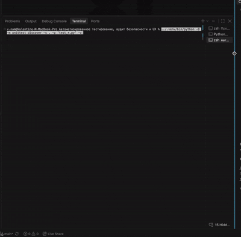

# Автоматизированное тестирование, аудит безопасности и UX

## Подготовка Python-окружения

Команды ниже выполняются **из каталога этого этапа**, в bash/zsh на macOS/Linux.
Требуется Python 3.11 или новее с модулями `venv` и `pip`; проверено на Python 3.13.
Все четыре этапа используют одно окружение `../.venv` и общий `../requirements.txt`.
При первом запуске создайте окружение и установите зависимости:

```bash
python3 -m venv ../.venv
../.venv/bin/python -m pip install -r ../requirements.txt
../.venv/bin/python -m pip check
```

Если общее окружение уже создано, повторно создавать его не нужно. Команды используют
его интерпретатор явно: активация не требуется. Системный `python3` после установки
по-прежнему может не видеть пакеты — запускайте приведённые ниже команды через `../.venv/bin/python`.
Для Windows PowerShell процедура и замена пути описаны в [общем README](../README.md).


Финальный аудит выполнен 11.10.2026. Полная таблица требований, исправлений и ограничений — в [AUDIT_REPORT.md](AUDIT_REPORT.md).

## Что проверяется

- `test_core_material.py`, `test_core_discount.py` повторно используют канонические тесты ядра: 12 тестов калькулятора и тест порогов скидки. Алгоритмы не дублируются.
- `test_final_app.py`: очистка CSV, расчёты, валидация, параметризация INSERT и UPDATE, наличие файлового обработчика логирования. Последний тест не подтверждает содержание реального журнала ошибок.
- `test_http_api.py`: настоящий временный HTTP-сервер, корректные и ошибочные запросы, 404, ошибки соединения, отсутствие внутренних деталей в ответах и передача Decimal без потери точности. Подключения psycopg2 заблокированы; ответы БД подменяются только в тестах.
- `test_live_readonly.py`: отдельный запуск против работающего приложения на `127.0.0.1:8010`. Только чтение партнёров, карточки, истории, справочников и POST расчёта. Нет запросов создания, изменения или удаления. Нагрузка ограничена 24 GET-запросами и четырьмя потоками.
- `test_ui.mjs`: семь сценариев в установленном Chrome через DevTools Protocol, без новых зависимостей. Отдельный временный профиль; все запросы записи партнёров перехватываются внутри браузерного теста. Рабочее приложение продолжает использовать PostgreSQL.

## Запуск

После установки зависимостей выше, из этого каталога (PostgreSQL и `.env` не требуются):

```bash
../.venv/bin/python -B -m unittest discover -s . -p 'test_*.py' -v
```

Ожидаемый обычный результат: 27 успешных тестов, три live-проверки пропущены. HTTP-тестам требуется разрешение на локальный listening socket.

Остальные наборы запускаются отдельно, из соответствующих каталогов:

```bash
# Каталог инфраструктуры данных: 22 успешных, один интеграционный пропущен
../.venv/bin/python -B -m unittest discover -s tests -v
# Каталог бизнес-логики: 16 успешных, семь интеграционных пропущены
../.venv/bin/python -B -m unittest discover -s . -v
# Каталог UI: семь успешных
../.venv/bin/python -B -m unittest discover -s tests -v
```

Не устанавливайте `STAGE1_ALLOW_DB_WRITE` и `STAGE2_ALLOW_DB_WRITE` для обычного аудита. Отдельные интеграционные тесты прежних этапов требуют проверенного изолированного кластера и описаны в их README.

Для live-проверок нужны PostgreSQL с импортом этапа 1 и сервер на порту 8010. В отдельном терминале откройте каталог UI и выполните `../.venv/bin/python -B server.py`. Затем из данного каталога:

```bash
FINAL_AUDIT_LIVE=1 ../.venv/bin/python -B -m unittest test_live_readonly -v
node test_ui.mjs
```

Браузерная проверка необязательна для Python-тестов. Её текущий запуск рассчитан на macOS: скрипт использует `/private/tmp` и стандартное расположение Chrome. На других ОС автоматическая переносимость этого сценария не подтверждена; используйте ручную проверку ниже. Node.js и Chrome устанавливаются отдельно, pip их не устанавливает.

Браузерный сценарий использует существующих партнёров и контрольный расчёт `(1, 2, 100, 1, 1) → 126`. Он не создаёт данные для подготовки окружения. Для Chrome вне стандартного пути macOS задайте `CHROME_PATH`. Нужен Node.js с глобальными `fetch` и `WebSocket` (проверено на v23.3.0). Скрипт сохраняет временный профиль в `/private/tmp/final-audit-chrome-*` и завершает только запущенный им Chrome.

## Фактический результат

- ETL: 22 успешно, один пропуск.
- Ядро: 16 успешно, семь пропусков.
- UI/backend и защита HTTP-файлов: семь успешно.
- Четвёртый этап: 27 успешно; live-набор запущен отдельно, три успешно.
- Chrome: семь сценариев успешно.
- Ограниченная нагрузка: 24/24 HTTP 200, 0,156 с суммарно; это smoke-проверка, не оценка предельной производительности.
- Python AST: 21 файл; JavaScript приложения: восемь файлов; синтаксис браузерного теста и `git diff --check` без ошибок.

Первые HTTP-запуски были заблокированы песочницей на открытии порта; повторный запуск с разрешением прошёл. Рабочая PostgreSQL не останавливалась, настройки, справочники и данные не менялись.

## Демонстрация


