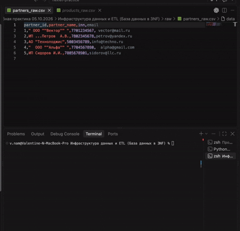

# Инфраструктура данных и ETL (База данных в 3NF)

## Подготовка Python-окружения

Команды ниже выполняются **из каталога этого этапа**, в bash/zsh на macOS/Linux.
Требуется Python 3.11 или новее с модулями `venv` и `pip`; проверено на Python 3.13.
Все четыре этапа используют одно окружение `../.venv` и общий `../requirements.txt`.
При первом запуске создайте окружение и установите зависимости:

```bash
python3 -m venv ../.venv
../.venv/bin/python -m pip install -r ../requirements.txt
../.venv/bin/python -m pip check
```

Если общее окружение уже создано, повторно создавать его не нужно. Команды используют
его интерпретатор явно: активация не требуется. Системный `python3` после установки
по-прежнему может не видеть пакеты — запускайте приведённые ниже команды через `../.venv/bin/python`.
Для Windows PowerShell процедура и замена пути описаны в [общем README](../README.md).


## Состав

- `raw/*.csv` — неизмененные копии исходных файлов из задания.
- `schema.sql` — схема `practice_2026_10_05`, совместимый переход с прежнего DDL этой практики и представление `data_quality_checks`.
- `etl.py` — очистка, валидация, добавление отсутствующих записей, проверка фактически сохраненных значений.
- `validation.py` — общая валидация партнеров для ETL и финального API.
- `sync_partner_sequence.sql` — синхронизация генератора ID после явных ID из CSV.
- `select_count.sql` — независимый аудит в read-only транзакции.
- `tests/test_etl.py` — проверки преобразований, конфликтов и общей валидации без БД.
- `tests/test_postgres.py` — отдельно разрешаемый интеграционный сценарий на пустой одноразовой БД; по умолчанию пропускается.
- `etl_rejections.csv` — генерируемый отчет: имя файла, номер строки, причина отклонения. Отчет описывает преобразование CSV, а не подтверждает commit.

## Модель и 3NF

| Таблица | Ключ и зависимости |
|---|---|
| `partners` | `partner_id → company_name, partner_type, inn, contact_email, phone, rating, address, director`; ИНН и email — альтернативные уникальные ключи |
| `products` | `product_id → product_name, list_price`; название уникально |
| `sales_history` | `sale_id → partner_id, product_id, sale_date, quantity, sale_amount` |
| `product_types` | `product_type_id → coefficient, data_source` |
| `material_types` | `material_type_id → scrap_percentage, data_source` |

Строка истории — отдельная продажа. Названия партнеров/товаров и текущие цены не копируются в историю. Составных ключей нет; неключевые атрибуты не зависят от других неключевых атрибутов в принятой модели. Наименование партнера хранится без юридической формы, тип — отдельно. Дополнительные сущности отгрузок для этих CSV не нужны: идентификатора документа в исходных данных нет.

`sale_amount` хранит ровно исходный `amount`. Историческая цена за единицу при необходимости вычисляется как `sale_amount / quantity`. Отдельно она не хранится: например, сумма 100.01 при количестве 3 не представима точной ценой с двумя знаками после запятой. `list_price` — текущий прайс, он не определяет сумму исторической продажи. Суммы не округляются молча: дробные копейки отклоняются в отчете.

При переходе с предыдущего DDL 05.10 колонка `unit_price_at_sale` переименовывается в `sale_amount`, расширяется до `DECIMAL(22,2)`, затем умножается на количество. Это сохраняет известную сумму старых записей; новых цен миграция не придумывает. Повторный запуск не умножает сумму снова. Несовместимые старые рейтинги или другие нарушения новых ограничений приводят к откату, а не к автоматическому исправлению пользовательских значений.

## Общие правила

- ИНН: ровно 10 или 12 ASCII-цифр; email: обязательный, нижний регистр, без пробелов, с `@` и доменом.
- Наименование: непустое, до 255 символов; текст очищается от крайних и повторных пробелов.
- Тип: ООО, АО, ЗАО, ПАО или ИП.
- Рейтинг: целое от 0 до 2147483647 (технический предел PostgreSQL INTEGER); в исходных CSV отсутствует, поэтому применяется явно заданный default 0. Искусственного бизнес-ограничения 5 нет.
- ID и количество: положительные INTEGER. Размеры строк проверяются до INSERT.
- Прайс: неотрицательный `DECIMAL(12,2)`; сумма продажи: неотрицательный `DECIMAL(22,2)`; NaN и бесконечности запрещены.
- Даты: DD.MM.YYYY, YYYY/MM/DD, YYYY-MM-DD, DD-MM-YYYY, YYYY.MM.DD.
- `partners_raw.csv`/`sales_history_raw.csv`: UTF-8; `products_raw.csv`: CP1251.

Для исходного набора: 5 партнеров, 3 товара, 5 продаж, 1 отклонение (`partner_id=999`, физическая строка 4 sales_history_raw.csv). Замена `A.B.` на `А.В.` и удаление `...` применяются только при очистке имен из предоставленного CSV.

## Справочники следующего задания

ETL загружает коэффициенты и проценты брака из существующего `../Реализация ядра бизнес-логики (Расчеты и алгоритмы)/demo_catalogs.py` — без второй копии значений. Каждая запись получает `data_source='demo'`. Это учебные значения проекта, не данные заказчика. Значение `customer` зарезервировано для подтвержденного источника.

Связь товаров CSV с типами не назначается: исходные данные такой связи не содержат. На этапе 2 алгоритм и API подключены к этим таблицам; демонстрационный модуль используется только ETL.

## Запуск и повторный импорт

Сначала выполните подготовку окружения выше. Даже режим `--check-only` импортирует сторонние пакеты, поэтому требует их установки, но не требует PostgreSQL. Исходные CSV находятся в отслеживаемом каталоге `raw`; доступ к DEV не нужен.

Проверка CSV без БД и без записи отчета:

```bash
../.venv/bin/python -B etl.py --check-only
```

Для импорта нужен запущенный PostgreSQL и заранее созданная БД, доступная вашей роли (установка сервера отдельно от pip; пошаговый порядок — в [общем README](../README.md)). Из этой папки создайте конфигурацию, если `.env` ещё нет:

```bash
cp -n .env.example .env
```

Откройте `.env` в редакторе и заполните все параметры для вашей БД, включая пароль. Не публикуйте этот файл. Параметры процесса имеют приоритет над `.env`; при отсутствии локальных значений используется прежний `.env` backend 14.09. Перед реальным импортом обязательно проверьте целевую БД. `DB_SCHEMA` допускается только `practice_2026_10_05`.

```bash
../.venv/bin/python -B etl.py
```

В одной транзакции создается/обновляется схема, блокируются таблицы от конкурирующей записи и добавляются отсутствующие записи. Совпадающие строки пропускаются. При одинаковом ID и отличающихся импортируемых полях весь запуск откатывается с сообщением о конфликте. Конфликт уникального ИНН/email/названия также откатывает запуск. Пользовательские записи и дополнительные поля партнеров не удаляются и не перезаписываются. Изменения рейтинга/адреса/телефона импорт не сравнивает, поскольку их нет в CSV.

Импорт печатает added/unchanged отдельно для каждой таблицы, сверяет все импортируемые значения с результатом преобразования и запускает общие проверки целостности. Подсчет общего количества строк не используется как доказательство полноты загрузки.

Режима сброса нет: `TRUNCATE`, `DELETE` и `DROP TABLE` не выполняются. Для повторного импорта сброс не требуется. При конфликте сначала сравните CSV и существующую запись, затем отдельно согласуйте исправление. Последовательность ID не перематывается назад; пропуски ID после отката допустимы, поскольку PostgreSQL `setval` не откатывается транзакцией.

`schema.sql` сам по себе требует транзакции (`psql -1 -v ON_ERROR_STOP=1 -f schema.sql`). Предпочтителен `etl.py`: он также синхронизирует последовательность после загрузки. Выполнять DDL и импорт в рабочей БД можно только после отдельного согласования.

Независимая проверка (требует `psql`; замените host/port/user/dbname на значения вашего `.env`, пароль запрашивается интерактивно; `psql` не читает `.env`):

```bash
psql -h localhost -p 5432 -U postgres -d practice_2026_autumn -W -v ON_ERROR_STOP=1 -f select_count.sql
```

Ожидания: `invalid_count=0`, пустые выборки расхождений исходного набора, `next_partner_id_is_free=true`, справочники с происхождением `demo`. После ручного редактирования расхождения с исходным набором могут быть намеренными. Проверки ETL используют текущий набор CSV; эталонные VALUES в SQL относятся именно к предоставленным исходникам.

## Тесты

```bash
../.venv/bin/python -B -m unittest discover -s tests -v
```

Обычные тесты не подключаются к PostgreSQL. Они не доказывают исполнимость DDL или работу реальных транзакций. Для реальной проверки нужны отдельная согласованная тестовая БД и сценарии: первоначальный/повторный импорт, INSERT партнера без ID, сохранение пользовательских данных, откат конфликта, переход со старой схемы, проверки ограничений и SQL-аудит.

Интеграционный `tests/test_postgres.py` не входит в стандартную проверку после клонирования. Он делает записи и требует отдельной пустой изолированной БД `stage1_etl_test`, Unix-сокета под `/private/tmp`, порта 55435, отключённого TCP и проверки реального каталога кластера. Тест включается переменными `STAGE1_ALLOW_DB_WRITE` и `STAGE1_TEST_DSN`; не задавайте их для обычных unit-тестов. Эти ограничения зафиксированы в исходнике и не являются переносимой инструкцией развёртывания. Воспроизведение требует отдельной подготовки окружения; текущий аудит не изменяет тестовые ожидания.

### Результат интеграционной проверки 10.10.2026

После отдельного разрешения проверка выполнена на новом временном кластере PostgreSQL, без TCP, в БД `stage1_etl_test`. Все 23 теста прошли (22 без БД и 1 комплексный интеграционный сценарий). Подтверждены чистый DDL, переход со старой схемы, импорт и повторные импорты, генерация ID через настоящий `server.save_partner`, чтение/список/история через backend, ограничения ИНН и рейтинга, сохранность пользовательских записей и откат вставки, выполненной до конфликта.

Независимый `select_count.sql` выполнен успешно: восемь проверок качества дали 0 нарушений, следующий ID свободен. Одно расхождение с CSV намеренное: имя партнера 1 изменено тестом, и повторный импорт сохранил ручную правку. Сервер тестового кластера остановлен; каталог данных не удален. Проверка HTTP и браузера в этот этап не входила.

## Демонстрация


